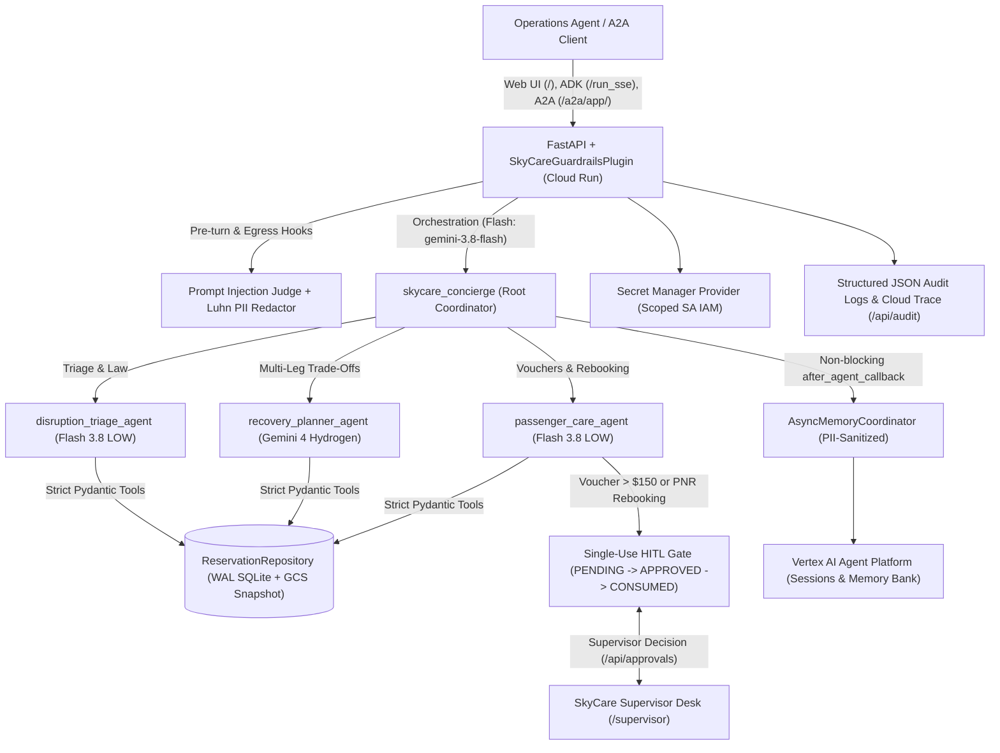

# SkyCare Concierge (`skycare-concierge`)

[](pyproject.toml)
[](https://google.github.io/adk-docs/)
[](app/core/config.py)
[](app/app_utils/a2a.py)
[](LICENSE)

**Problem.** Airline irregular operations (IRROPS) force disruption desk agents to cross-reference delayed flights, EU261/UK261/US DOT compensation law, multi-leg rebooking connections, passenger loyalty preferences, and voucher spend caps under time pressure — where hallucinated compensation, PII leaks, or unauthorized rebookings create immediate financial and regulatory liability.

**Solution.** **SkyCare Concierge** is an enterprise multi-agent AI **Airline Disruption & Passenger Recovery Desk** built on **Google ADK**, **Vertex AI Gemini (`gemini-3.8-flash` & `gemini-4-hydrogen`)**, **Vertex AI Agent Platform (`agent_platform_sessions` & Memory Bank)**, **FastAPI**, and **A2A**. It pairs `LOW`-thinking Flash triage/care agents and deterministic PNR pre-warming with a hedged Gemini 4 (`gemini-4-hydrogen`) multi-leg recovery planner behind deterministic code policy checks, runtime prompt-injection guardrails, PII redaction, and single-use Human-in-the-Loop (HITL) supervisor approvals.

---

## Architecture



---

## Multi-Agent Routing & Safety Model

| Component | Model / Enforcement | Responsibility |
| --- | --- | --- |
| `skycare_concierge` | `gemini-3.8-flash` (`LOW`) | Root coordinator, deterministic PNR pre-warm (`before_agent_callback`), `PreloadMemoryTool`, delegation, compaction (`24k` threshold), and context caching |
| `disruption_triage_agent` | `gemini-3.8-flash` (`LOW`) | PNR lookup (`lookup_passenger_reservation`) and deterministic EU261 / UK261 / US DOT calculation (`check_eu261_dot_compensation_eligibility`) |
| `recovery_planner_agent` | `gemini-4-hydrogen` (`LOW`, hedged) | Deep multi-leg alternate scoring (`search_alternate_itineraries`, `calculate_rebooking_options`) factoring MCT, arrival deadlines, and seat/meal preferences |
| `passenger_care_agent` | `gemini-3.8-flash` (`LOW`) | Policy-gated fulfillment (`issue_hotel_meal_voucher`, `execute_passenger_rebooking`) |
| **HITL Policy & Replay Defense** | Pure code (`repository.py` + ADK) | Auto-approves vouchers `<= $150.00`; blocks vouchers `> $150.00` and all PNR rebookings until supervisor approval (`APPROVED -> CONSUMED`, `409 Conflict` on replay) |
| **Runtime Guardrails Plugin** | `SkyCareGuardrailsPlugin` | Regex + Flash `PromptSafetyVerdict` injection screening, automatic `is_user_prompt_safe` reset to prevent session poisoning, and recursive secret/SSN/passport/Luhn-card masking |
| **Zero-BigQuery Storage ADR** | Option #1 (`agent_platform_sessions` + SQLite/GCS) | Regional `us-east1` Agent Platform sessions/Memory Bank paired with WAL SQLite + GCS snapshots; `cloud_sql` PostgreSQL 15 documented as Option #2 ADR in [docs/ARCHITECTURE.md](docs/ARCHITECTURE.md) |

---

## Seeded Demo & Walkthrough Scenarios

Start locally or open the deployed Web UI (`/`), then walk through all four seeded cases (detailed steps in [docs/DEMO_GUIDE.md](docs/DEMO_GUIDE.md)):

| PNR | Passenger & Route | Disruption Scenario | What It Demonstrates |
| --- | --- | --- | --- |
| `SKY842` | Elena Rostova (`Gold`) · `JFK -> LHR -> ZRH` | `SC402` cancelled (Crew Timeout / Storm) | Flash triage → **Pro** multi-leg vs. nonstop (`SC408`) optimization + UK/EU261 EUR 600 + HITL rebooking gate |
| `SKY319` | Marcus Vance (`Silver`) · `ORD -> SFO -> NRT` | `SC118` delayed `200m` (Mechanical) | High-value `$210` hotel voucher exceeding `$150.00` cap → **Supervisor Desk (`/supervisor`)** block/approve + live passenger update |
| `SKY905` | Priya Nair (`Platinum`) · `ATL -> BOS` | `SC214` delayed `75m` (ATC Weather) | Low-value `$35` meal voucher → immediate policy auto-approval (`VCH-...`) |
| `SKY404` | David Kim (`Blue`) · `LAX -> SEA` | None (`SC510` On Time) | Negative control (refuses false compensation) |

---

## Quick Start (Local, No GCP Required)

### 1. Prerequisites
- Python `>=3.11,<3.14` and [`uv`](https://docs.astral.sh/uv/)
- `google-agents-cli >= 1.15.0`
- Optional for live Vertex AI / Cloud Run: `gcloud` CLI (with ADC) and Terraform `>= 1.11.0`

### 2. Install & Run Locally
```bash
uv sync --dev --extra lint

# Run locally with in-memory ADK sessions (no remote Agent Runtime required)
USE_IN_MEMORY_SESSION=true uv run uvicorn app.fast_api_app:app --host 127.0.0.1 --port 8000 --reload
```

Open:
- **SkyCare Passenger Concierge UI**: `http://127.0.0.1:8000/` (and `/ui`)
- **SkyCare Supervisor Desk UI**: `http://127.0.0.1:8000/supervisor`
- **ADK Dev UI**: `http://127.0.0.1:8000/dev-ui/`
- **OpenAPI Docs**: `http://127.0.0.1:8000/docs`
- **A2A Agent Card**: `http://127.0.0.1:8000/a2a/app/.well-known/agent-card.json`

---

## Verification & Evaluation

```bash
# Lint, formatting check, spellcheck, and static type check (ruff, codespell, ty)
agents-cli lint

# Offline unit + bilingual FastAPI / HITL / A2A E2E tests (21 tests, zero network calls)
USE_IN_MEMORY_SESSION=true uv run pytest tests/unit tests/integration/test_offline_api_e2e.py -v

# Live Vertex AI bilingual (EN/ES) integration & A2A tests (5 tests, total 26 pytest cases; requires Vertex AI credentials)
USE_IN_MEMORY_SESSION=true uv run pytest tests/integration/test_agent.py tests/integration/test_server_e2e.py -v

# Live 9-case bilingual (EN/ES) golden evaluation suite (threshold: custom_response_quality >= 4.0)
agents-cli eval run --project your-gcp-project-id --region us-east1 --concurrency 2 --qps 5
```

---

## Deployment, IaC & CI/CD

- **Single-Project Cloud Run Deploy** (documented in full in [docs/DEPLOYMENT.md](docs/DEPLOYMENT.md)):
  - Terraform (`deployment/terraform/single-project/`) provisions APIs (including Vertex AI, Artifact Registry, Cloud Build, Cloud Run, Secret Manager — **no BigQuery**), Agent Identity IAM roles, GCS bucket, Secret Manager secret containers, and Cloud Logging metrics.
  - `agents-cli deploy --region us-east1` builds the container via Cloud Build and deploys `skycare-concierge` on Cloud Run with `--no-allow-unauthenticated` and optional Identity-Aware Proxy (`--iap`) for browser SSO.
- **GitHub Actions CI/CD** (`.github/workflows/`):
  - **`ci.yaml`**: Runs `ruff check`, `ruff format --check`, `codespell`, `ty check`, offline unit + E2E `pytest`, and Terraform `fmt` + `validate` on every `push` to `main` and `pull_request` (zero secrets required).
  - **`staging.yaml` & `deploy-to-prod.yaml` & `pr_checks.yaml`**: Workload Identity Federation (WIF) multi-project Cloud Run deployment & Locust load-test promotion workflows paired with `deployment/terraform/cicd/` (automatically skipped when `vars.CICD_PROJECT_ID` / `vars.STAGING_PROJECT_ID` are not configured).

---

## Project Structure

```text
skycare-concierge/
├── .github/workflows/           # CI quality/Terraform checks + guarded WIF staging/prod CD
├── app/
│   ├── agent.py                 # Root coordinator, App config, compaction, caching, resumability
│   ├── fast_api_app.py          # FastAPI server, custom Web UI routes, HITL/audit APIs, A2A mount
│   ├── agents/specialists.py    # Flash triage/care and Pro recovery planner sub-agents
│   ├── app_utils/               # A2A wiring, Agent Platform runtime, Memory Bank config
│   ├── core/config.py           # Centralized SkyCareSettings and Vertex AI env/client builder
│   ├── memory/async_memory.py   # AsyncMemoryCoordinator & pre-write PII session sanitizer
│   ├── observability/logging.py # Structured JSON Cloud Logging, OTel trace IDs, audit ring buffer
│   ├── plugins/safety_guardrails.py # SkyCareGuardrailsPlugin (jailbreak, injection, PII scrubbing)
│   ├── security/                # Luhn-validated PII redactor & Secret Manager provider abstraction
│   ├── storage/repository.py    # WAL SQLite + optional GCS snapshot repository & HITL state machine
│   ├── tools/                   # Strict Pydantic schemas & 6 airline recovery tools
│   └── web/                     # Bilingual (EN/ES) SkyCare Passenger (/) & Supervisor (/supervisor) UIs
├── deployment/terraform/        # Single-project and CI/CD (WIF) Terraform IaC (no BigQuery)
├── docs/                        # Architecture, AgentOps Matrix, Security, Deployment, Demo guides
├── tests/
│   ├── eval/                    # 9-case bilingual (EN/ES) golden dataset, Gemini judge, config
│   ├── integration/             # Offline FastAPI E2E, live ADK stream, live SSE/A2A server tests
│   ├── load_test/               # Locust load test target
│   └── unit/                    # Security, logging, tools, repository, plugin, and memory tests
├── Dockerfile
├── agents-cli-manifest.yaml
├── pyproject.toml
├── CONTRIBUTING.md
└── LICENSE
```

## Documentation Index

- [Architecture & Storage ADR](docs/ARCHITECTURE.md)
- [AgentOps Code Review Matrix (19 Criteria / 95 Points)](docs/AGENTOPS_MATRIX.md)
- [Security, PII Redaction & Secret Management](docs/SECURITY_AND_PRIVACY.md)
- [Deployment & Operations Guide](docs/DEPLOYMENT.md)
- [Live Demo & Walkthrough Guide (`SKY842`, `SKY319`, `SKY905`, `SKY404`)](docs/DEMO_GUIDE.md)

## License

Licensed under the [Apache License, Version 2.0](LICENSE).
