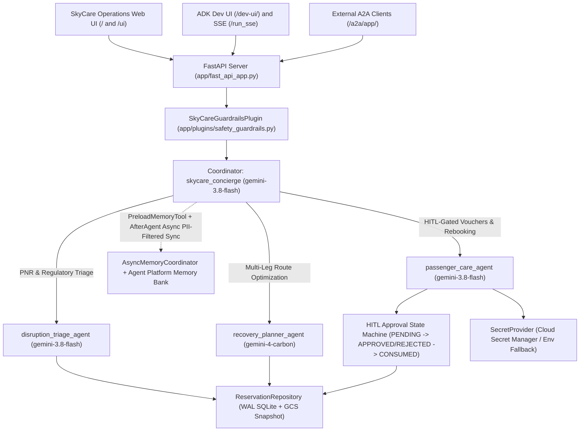

# SkyCare Concierge Architecture

SkyCare Concierge (`skycare-concierge`) is an enterprise multi-agent airline disruption & passenger recovery platform built on Google ADK (`google-adk`), Vertex AI Gemini (`gemini-3.8-flash` & `gemini-4-carbon`), Vertex AI Agent Platform (`agent_platform_sessions` + Memory Bank), FastAPI, and A2A (Agent2Agent).

## 1. System Topology & Strategic Model Routing

### Model Tier Selection Rationale

All models run against Vertex AI `location="global"` where Gemini 3.8 Flash and Gemini 4 Carbon publisher models are hosted, while the regional Agent Engine runtime hosts `agent_platform_sessions` and Memory Bank in `us-east1`:

| Component | Model / Setting | Tier | Responsibility |
| --- | --- | --- | --- |
| `skycare_concierge` | `gemini-3.8-flash` | Flash | Low-latency orchestration, intent classification, memory preloading, and direct PNR lookups |
| `disruption_triage_agent` | `gemini-3.8-flash` | Flash | Disruption cause synthesis and deterministic EU261 / UK261 / US DOT verification |
| `recovery_planner_agent` | `gemini-4-carbon` | Pro / Frontier | Multi-leg connection risk reasoning, arrival trade-offs, fare-waiver scoring, preference fit |
| `passenger_care_agent` | `gemini-3.8-flash` | Flash | Strict schema validation, duty-of-care voucher issuance, and HITL-gated PNR commits |
| Prompt Safety Judge | `gemini-3.8-flash` (`temperature=0.0`) | Flash | Secondary semantic screening (`PromptSafetyVerdict`) after deterministic regex rules |
| Context Compaction | `LlmEventSummarizer` (`gemini-3.8-flash`) | Flash | Incremental summarization past `24000` tokens retaining last `6` events |

## 2. Context Engineering, Compaction & Caching

Configured in `app/agent.py`:

- **Instruction Separation & Prefix Caching**: System invariants live in `Agent.static_instruction` while mutable session variables (`{active_pnr?}`, `{active_origin?}`, `{active_destination?}`, `{recommended_itinerary_id?}`) live in `Agent.instruction`.
- **Context Caching**: `ContextCacheConfig(min_tokens=2048, ttl_seconds=1800, cache_intervals=10)` caches static instruction/tool schemas cleanly across turns.
- **Events Compaction**: `EventsCompactionConfig(summarizer=LlmEventSummarizer(llm=Gemini(model=_settings.flash_model)), token_threshold=24000, event_retention_size=6)` keeps long recovery sessions bounded without losing passenger context.
- **Resumability**: `ResumabilityConfig(is_resumable=True)` paired with `FunctionTool(require_confirmation=_requires_native_adk_confirmation)` supports native ADK confirmation pause/resume (`SKYCARE_NATIVE_ADK_CONFIRMATION=true`) in addition to the persistent database approval queue.

## 3. Asynchronous Cross-Session Memory Architecture

Memory operations are decoupled from foreground user latency (`app/memory/async_memory.py` and `app/app_utils/memory_config.py`):

1. **Preload on Turn Start**: `root_agent` includes `PreloadMemoryTool()` to retrieve remembered seating (`aisle`, `window`), dietary (`vegetarian`, `vegan`), and connection risk preferences at conversation start.
2. **PII Scrubbing Before Indexing**: `after_agent_memory_callback` triggers `AsyncMemoryCoordinator.schedule(callback_context)`, which executes `sanitize_session_for_memory(session)`:
   - Deep-copies events and masks every text part using `redact_text(...)`.
   - Filters `session.state` through `_ALLOWED_MEMORY_STATE_KEYS` (`active_pnr`, `active_origin`, `active_destination`, `active_cabin`, `active_loyalty_tier`, `recommended_itinerary_id`, `traveler_preferences`) and passes values through `redact_payload(...)`.
3. **Non-Blocking Consolidation & Shutdown Flush**: `asyncio.create_task` executes `memory_service.add_session_to_memory(sanitized)` out-of-band, and `app/fast_api_app.py` awaits `get_memory_coordinator().flush(timeout=5.0)` inside FastAPI lifespan shutdown.
4. **Vertex AI Memory Bank Customization**: `build_memory_bank_config()` registers `CustomMemoryTopic(label="traveler_seating_and_cabin_preferences", ...)` plus `ManagedTopicEnum` values (`USER_PREFERENCES`, `KEY_CONVERSATION_DETAILS`, `EXPLICIT_INSTRUCTIONS`), deliberately excluding `USER_PERSONAL_INFO` so personal identity data is never auto-extracted.

## 4. Human-in-the-Loop (HITL) Approval State Machine

Irreversible operational changes and expenditures exceeding policy thresholds require explicit supervisor approval (`app/tools/airline_tools.py`, `app/storage/repository.py`, `app/fast_api_app.py`):

```mermaid
stateDiagram-v2
    [*] --> AutoApproved: "Voucher <= $150 USD"
    [*] --> PENDING: "Voucher > $150 USD OR Any PNR Rebooking"
    PENDING --> APPROVED: "Supervisor POST /api/approvals/{id}/decision approved=true"
    PENDING --> REJECTED: "Supervisor POST /api/approvals/{id}/decision approved=false"
    APPROVED --> CONSUMED: "Tool re-invoked with matching PNR and payload"
    REJECTED --> [*]: "Tool surfaces rejection without mutating PNR"
    CONSUMED --> [*]: "Single-use token exhausted; replay creates new PENDING"
```

- **Replay Prevention**: Once `issue_hotel_meal_voucher` or `execute_passenger_rebooking` executes an `APPROVED` request, `repo.consume_approval_request(approval_id)` atomically transitions `APPROVED -> CONSUMED` (guarded by `WHERE status = 'APPROVED'`) so an agent or replay cannot reuse an old authorization.
- **Double-Decision Concurrency Protection**: `POST /api/approvals/{approval_id}/decision` returns `409 Conflict` if an approval is no longer `PENDING`.

## 5. Architecture Decision Record (ADR): Operational Storage & Analytics

### Context
SkyCare Concierge needs transactional state for PNRs, flight segments, vouchers, rebookings, and HITL supervisor approvals, alongside cross-session conversation memory and production telemetry. We evaluated two architecture options:
- **Option #1 (Selected): Agent Platform Sessions & Memory Bank + WAL SQLite / GCS Snapshot (`ReservationRepository`) + Cloud Logging/Trace**
- **Option #2 (Future Scale Alternative): Managed Cloud SQL (PostgreSQL 15) + VPC Serverless Connector + Agent Platform**

### Decision
We implemented **Option #1** with **zero BigQuery dependencies** in runtime packages (`pyproject.toml`) or Terraform (`deployment/terraform/`):
- **Conversation State & Long-Term Memory**: Handled by Vertex AI Agent Platform (`agentengine://<runtime>` in `us-east1` via `app/app_utils/services.py`), with `InMemorySessionService` / `InMemoryMemoryService` fallback for isolated tests (`USE_IN_MEMORY_SESSION=true`).
- **Operational Booking & HITL Persistence**: Handled by thread-safe WAL-mode SQLite (`ReservationRepository` in `app/storage/repository.py`) with optional GCS object snapshot restore/sync (`state/skycare.db` in `LOGS_BUCKET_NAME`).
- **Telemetry & Audit**: Handled by Cloud Trace OpenTelemetry export and structured JSON Cloud Logging (`hitl_gate_events`, `pii_redaction_events` log-based metrics in `deployment/terraform/*/telemetry.tf`) without provisioning BigQuery datasets or analytics tables.

### Trade-Offs & Migration Path to Option #2 (`cloud_sql` PostgreSQL 15)
- **Why Option #1 Now**: Eliminates Cloud SQL cold-start overhead, VPC connector cost, and database migrations for single-instance Cloud Run deployments, interactive evaluation, and reproducible hackathon/demo setups while preserving strict ACID transactions (`PENDING -> APPROVED -> CONSUMED`) on local disk + GCS backup.
- **When to Adopt Option #2**: Multi-replica horizontal Cloud Run autoscaling with concurrent cross-instance bookings requires moving from single-writer SQLite + GCS snapshots to **Cloud SQL for PostgreSQL 15** (`google_sql_database_instance` in Terraform + `asyncpg`/`psycopg` pool behind the existing `ReservationRepository` interface). Because all tools and REST handlers already isolate SQL behind `ReservationRepository`, migrating to Option #2 requires swapping only the repository backend without changing ADK agents, plugins, tools, or UI contracts.
